<div align="center">


# KNOUX AI **PRO**

### Born on Android. Built with evidence. Shaped by KNOUX.

**تطبيق Android أصلي — رحلة استعادة وبناء وتطوير، من الهاتف إلى مستودع مستقل**

Kotlin · Jetpack Compose · Material 3 · Android 26–36 · Arabic / English

**Private engineering repository · Mobile-development lane · Historical record**

[Explore the screens](#the-visual-universe) · [Our story](#the-story--سجل-التطور) · [Verification](#evidence--what-is-actually-proven) · [Build](#building-the-android-app)

</div>

---

> [!IMPORTANT]
> **This is KNOUX AI Pro, not the Windows-developed KNOUX AI repository.**
> These are two **independent histories and development lanes**, even when both build an Android app with similar package identifiers. No automatic merging, mirroring, overwriting, or cross-repository push.

## The visual universe

The gallery below uses **real, version-controlled KNOUX reference art** from this repository — not stock imagery, generated “success” screens, or invented Android measurements. The approved KNOUX emblem, colors and identity assets remain preserved.

<table>
  <tr>
    <th align="center">01 · Awakening</th>
    <th align="center">02 · Home Intelligence</th>
    <th align="center">11 · Smart Clean</th>
    <th align="center">05 · Deep Scan</th>
  </tr>
  <tr>
    <td align="center">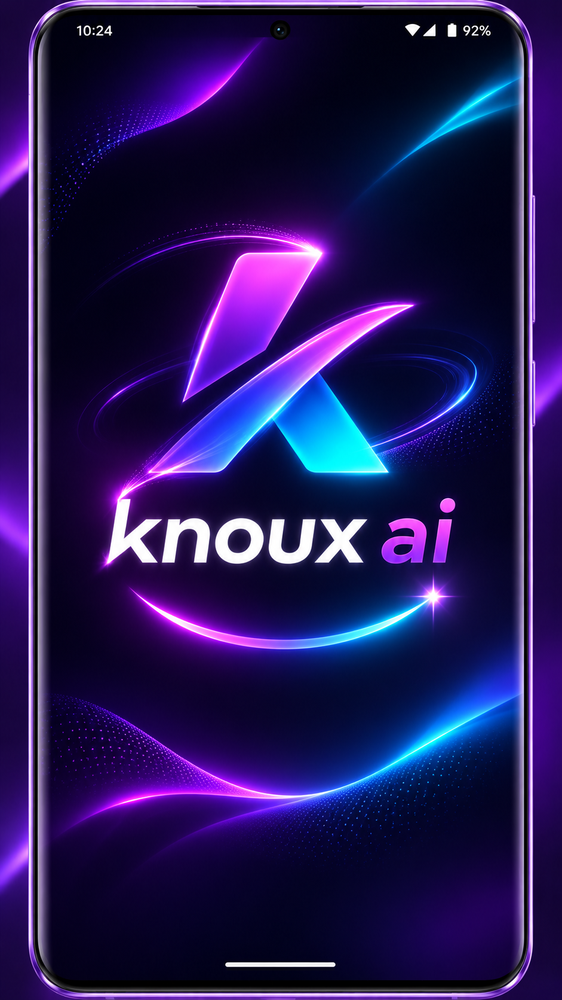</td>
    <td align="center">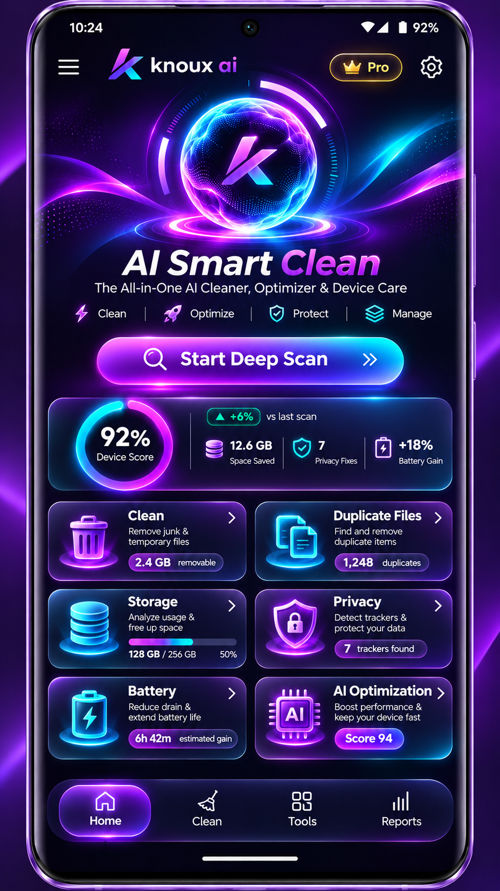</td>
    <td align="center">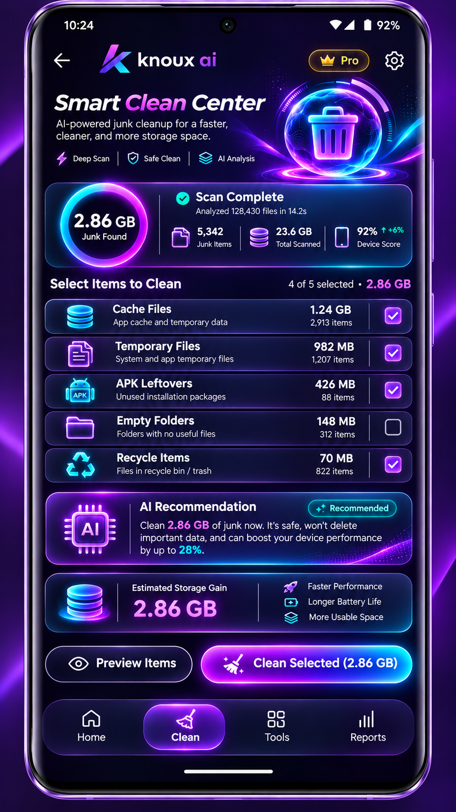</td>
    <td align="center">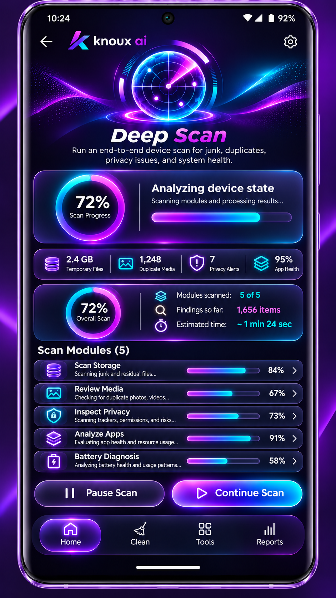</td>
  </tr>
</table>

<table>
  <tr>
    <th align="center">04 · Duplicate Finder</th>
    <th align="center">03 · Privacy Sweep</th>
    <th align="center">09 · Battery</th>
    <th align="center">06 · Reports</th>
  </tr>
  <tr>
    <td align="center">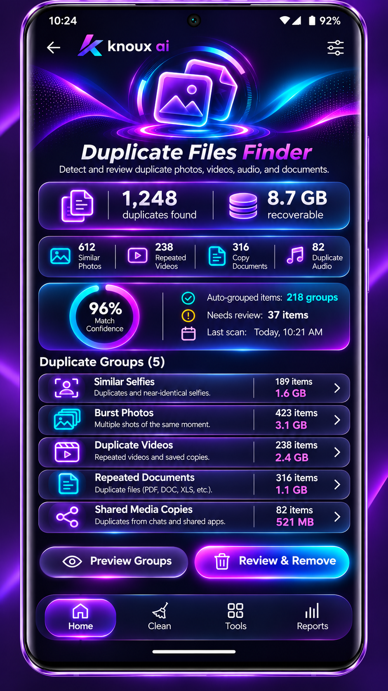</td>
    <td align="center">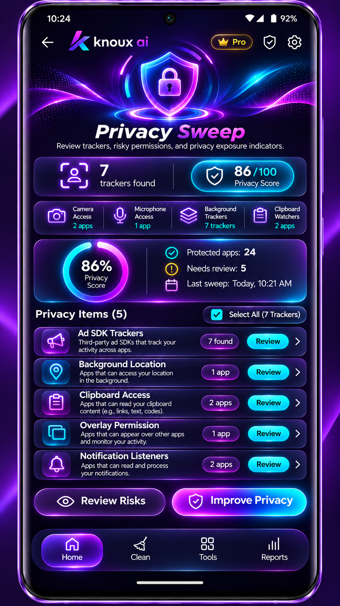</td>
    <td align="center">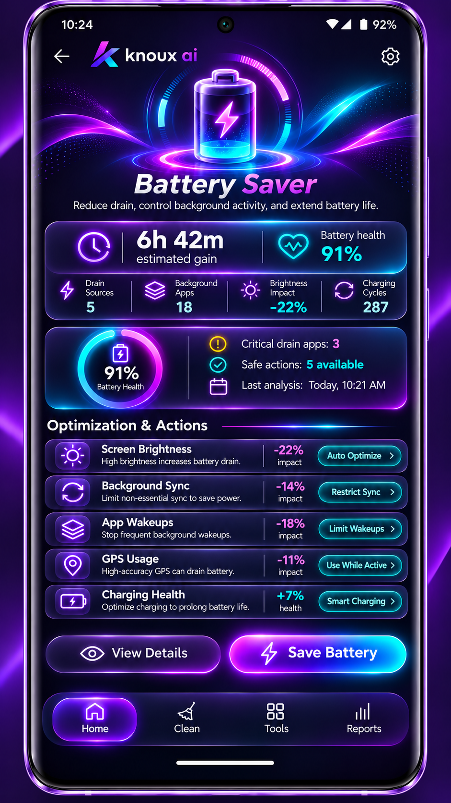</td>
    <td align="center">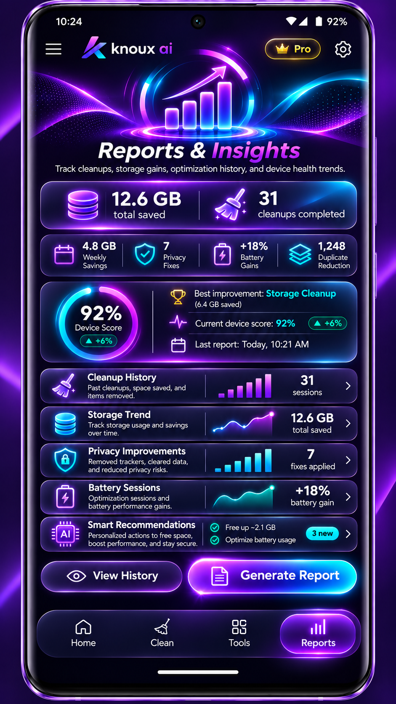</td>
  </tr>
</table>

<details>
<summary><strong>Explore all 20 preserved reference screens</strong></summary>

| Chapter | Reference | Chapter | Reference |
|---|---|---|---|
| 01 · Splash | [Original](design/refs20_complete/01_Splash_Logo_Smile.png) | 11 · Smart Clean | [Original](design/refs20_complete/11_Smart_Clean_Center.png) |
| 02 · Home | [Original](design/refs20_complete/02_Home_Dashboard.png) | 12 · Duplicate Group | [Original](design/refs20_complete/12_Duplicate_Group_Review.png) |
| 03 · Privacy Sweep | [Original](design/refs20_complete/03_Privacy_Sweep.png) | 13 · Privacy Risk | [Original](design/refs20_complete/13_Privacy_Risk_Inspector.png) |
| 04 · Duplicate Files | [Original](design/refs20_complete/04_Duplicate_Files_Finder.png) | 14 · Scan Summary | [Original](design/refs20_complete/14_Deep_Scan_Summary.png) |
| 05 · Deep Scan | [Original](design/refs20_complete/05_Deep_Scan.png) | 15 · Performance Detail | [Original](design/refs20_complete/15_Performance_Report_Detail.png) |
| 06 · Reports | [Original](design/refs20_complete/06_Reports_Insights.png) | 16 · Residue Review | [Original](design/refs20_complete/16_Residue_Item_Review.png) |
| 07 · App Residue | [Original](design/refs20_complete/07_App_Residue_Cleanup.png) | 17 · Installed Apps | [Original](design/refs20_complete/17_Installed_Apps_Review.png) |
| 08 · Storage | [Original](design/refs20_complete/08_Storage_Analyzer.png) | 18 · Storage Breakdown | [Original](design/refs20_complete/18_Storage_Breakdown.png) |
| 09 · Battery | [Original](design/refs20_complete/09_Battery_Saver.png) | 19 · Battery Diagnostics | [Original](design/refs20_complete/19_Battery_Diagnostics.png) |
| 10 · AI Optimization | [Original](design/refs20_complete/10_AI_Optimization.png) | 20 · AI Recommendations | [Original](design/refs20_complete/20_AI_Recommendations.png) |

These assets became part of the canonical recovery commit on **14 November 2026**. An earlier, dated November 11 audit had access to fewer references; do not mistake that historical limitation for the current file inventory.

</details>

### From reference to Android runtime

<div align="center">
<table>
<tr><th>Historical reference-vs-app review</th><th>Debug-app capture from the phone</th></tr>
<tr>
<td>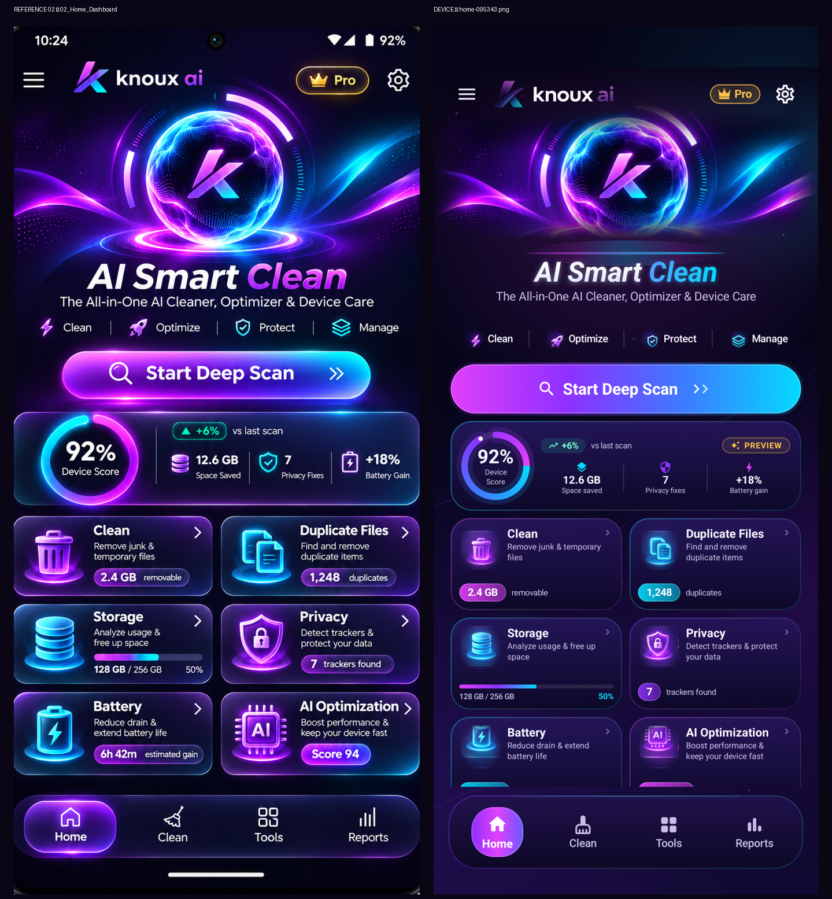</td>
<td>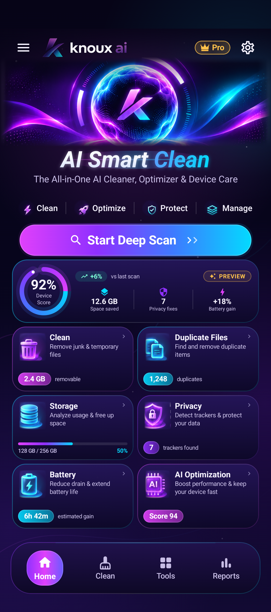</td>
</tr>
<tr>
<td colspan="2" align="center"><em>These files are historical visual evidence, not certification of the latest APK or current visual approval.</em></td>
</tr>
</table>
</div>

---

## The story — سجل التطور

**KNOUX** هي الهوية الأم. **KNOUX AI** هو المنتج. أما **KNOUX AI Pro** فهو مسار تطوير مستقل لهذا المنتج، وُلد من تجربة بناء Android أصلية على الهاتف، ثم استعادة أعمال وملفات وصور وأدلة في مستودع GitHub خاص.

لم تبدأ الحكاية من README جميل؛ بدأت بالاحتفاظ بالمرجع الحقيقي، ثم إصلاح أخطاء Kotlin، ثم بناء أول APK، ثم تحسين الابتسامة والـSplash، ثم التوثيق البصري، وأخيرًا استعادة الشغل وإضافة مسارات المصادقة إلى الكود.

| تاريخ | محطة حقيقية في Git | دليل تاريخي |
|---|---|---|
| **10 Nov 2026** | تجميع حزمة المصادر والـUI والـPlay-policy والمراجع؛ لم تكن APK جاهزة وقت إعداد الحزمة | [Original delivery notes](README_START_HERE_AR.md) |
| **11 Nov · Foundation** | استعادة سورس Phase 1، وترسيخ نسخ الصور والـPreview honest states | [\`5f46ac9\`](https://github.com/daynightae-cmyk/KNOUX-AI-Pro/commit/5f46ac9a57226889f0c31ab4f6039c5e3c2c9b32) |
| **11 Nov · First build** | إصلاح أخطاء Kotlin والوصول لأول Debug Build موثق | [\`58d2cac\`](https://github.com/daynightae-cmyk/KNOUX-AI-Pro/commit/58d2cac184adc048ab277aeeac65248c4cd3174d) |
| **11 Nov · Cinematic identity** | ظهور Splash السينمائي والصوت وشاشات التفاصيل والتنقل | [\`e344e22\`](https://github.com/daynightae-cmyk/KNOUX-AI-Pro/commit/e344e221aa99d0a716e74b53a8135e08e070d8d0) |
| **11 Nov · Visual integration** | تحسين LTR وSplash وPreview disclosures ومسار التقاط الصور | [\`e43b234\`](https://github.com/daynightae-cmyk/KNOUX-AI-Pro/commit/e43b2349af5797a545ecc620eca0d66189a7cd1c) |
| **11 Nov · Provenance** | تدقيق الوكلاء المتزامنين وجرد الصور عالية الدقة والأدلة | [\`cffe7b4\`](https://github.com/daynightae-cmyk/KNOUX-AI-Pro/commit/cffe7b4f7cc1de4beb5539202dbcf067de19741e) |
| **14 Nov · Canonical recovery** | استعادة أعمال UI إضافية وصور 20 خدمة، وإضافة طبقة Supabase Auth وواجهات المصادقة | [\`b271d8c\`](https://github.com/daynightae-cmyk/KNOUX-AI-Pro/commit/b271d8ca78839b5e45d4abce979e4136be912aad) |

> **Historical integrity:** The timeline describes commits that were actually found in this repository. It does **not** claim that work which remained only in a lost phone application, uncommitted folder, or old archive was automatically restored.

### The cinematic signature

- KNOUX's approved emblem and smile were implemented as a staged Splash animation.
- The dated visual-pass notes describe a **3.1-second composition**, staged strokes, final sparkle, one click sound and a **380 ms** fade into Home.
- The earlier build logs verify packaging. Actual audio synchronization for every current device/build still needs a captured runtime check.
- Approved artwork is preserved in the repository; visual references are not a license to replace the identity.

**Historical source:** [Visual baseline](qa-evidence/knoux-ai-visual-finish/BASELINE.md) · [Splash storyboard](qa-evidence/knoux-ai-visual-finish/SPLASH_STORYBOARD.md).

---

## What lives in the source today

| Layer | In the repository | What it means |
|---|---|---|
| **Android foundation** | Kotlin, Jetpack Compose, Material 3, Navigation | Native Android code, not a WebView mockup |
| **Customer UI** | Home, Clean, Tools, Reports, App Manager, detailed service routes | Implemented surfaces and navigation; some service values are still design previews |
| **Visual system** | 20 references, high-resolution originals, approved icons, service illustrations, Splash audio | Real artwork and assets, kept separately from live device measurements |
| **Authentication source** | \`KnouxAuthApi\`, Google Credential Manager, Email/OTP, Passkey ceremony, biometric session unlock | **Code present** at recovery commit; server settings and device E2E still need validation |
| **Debug evidence** | PixelCopy uploader, QaPoller, runtime screenshots, recorded build logs | Inspectable artifacts, not automatic production approval |
| **Platform services** | Android settings handoffs and battery signals | A limited number of real Android API interactions; full scanning/cleaning is **not verified** in this branch |
| **Product ambition** | Service missions, architecture and policy documents | Future E2E implementation contract; planning docs alone are not shipped features |

<details>
<summary><strong>Open the source-level architecture</strong></summary>

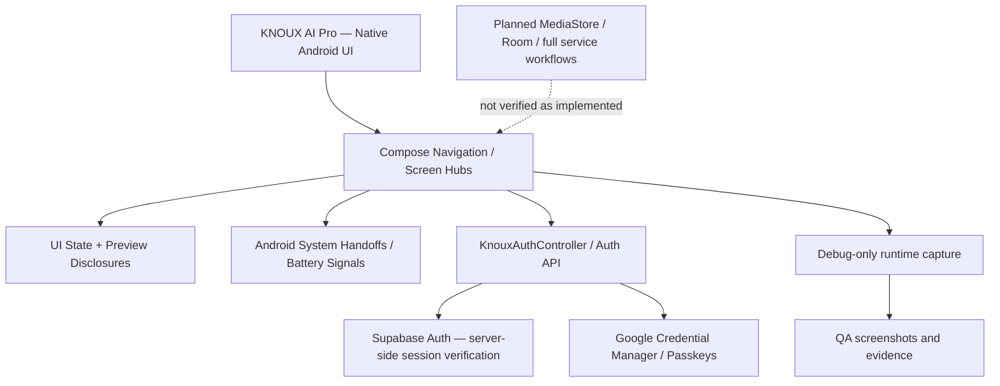

</details>

## Evidence — what is actually proven

**Source snapshot for this README:** \`master\` @ \`b271d8ca78839b5e45d4abce979e4136be912aad\`, inspected **14 November 2026**.

| Claim | Evidence available | Honest status |
|---|---|---|
| GitHub holds the recovered mobile source | Tracked source, assets and commit history | **VERIFIED IN GIT** |
| Twenty complete visual-reference PNGs are tracked | \`design/refs20_complete/01–20\` | **VERIFIED IN GIT** |
| Archived UI screenshots exist | \`qa-evidence/runtime/\` contains historical debug PNGs | **FILES VERIFIED**; not all latest-build captures |
| November 11 visual pass built an APK | Logs, exact APK SHA-256 and signed-off build record | **HISTORICAL BUILD VERIFIED BY RECORDED LOGS** |
| November 14 recovery code compiles/runs on a real device | No current-build compilation/runtime result independently confirmed in this README | **NOT YET RE-VERIFIED** |
| Google, Email/OTP, Passkeys, biometric login are E2E working | Source files for flows exist; correct provider, certificates and session behavior still need testing | **IMPLEMENTED IN CODE / RUNTIME UNVERIFIED** |
| Full storage recovery, duplicate deletion, residue cleanup, Pro services | Source includes UI and planning, not full demonstrated OS-confirmed service evidence | **NOT CLAIMED COMPLETE** |
| Play Store release / production publication | No production release evidence | **NOT RELEASED** |

The November 11 debug-build evidence records **AGP 8.9.3, Kotlin 2.1.0, JDK 17, Gradle 8.11.1**, and a then-current APK SHA-256 of \`e6d929e6377eda1a595ebbb0b2fb2f9f93125d6059c7bd1939dd1fb0d2276a4e\`. That SHA identifies **that historical build**, not the post-recovery source.

**Read the receipts:** [Build test log](qa-evidence/knoux-ai-visual-finish/TEST_RESULTS.md) · [Phone runtime capture method](qa-evidence/runtime/README.md) · [Fake closure gate](docs/testing/FAKE_CLOSURE_PRODUCTION_GATE.md) · [Screen map](qa-evidence/knoux-ai-visual-finish/SCREEN_MAP.md).

### The zero-fake-closure covenant

A successful \`assembleDebug\` does not prove navigation, visual parity, data safety or service execution. “Code exists” does not mean OAuth providers accept a real sign-in. Runtime screenshots from earlier commits do not prove a newer APK works. Every claim belongs to a recorded SHA, device/build variant, tests, screenshots and permissions state.

---

## Two repositories. Two independent engineering lanes.

| Identity | Canonical GitHub repository | Windows checkout | Development origin |
|---|---|---|---|
| **KNOUX AI** | [\`daynightae-cmyk/KNOUX-AI\`](https://github.com/daynightae-cmyk/KNOUX-AI) | \`D:\KNOUX-AI\` | PC-developed Android |
| **KNOUX AI Pro** · **this repository** | [\`daynightae-cmyk/KNOUX-AI-Pro\`](https://github.com/daynightae-cmyk/KNOUX-AI-Pro) | \`K:\KNOUX-AI-Pro\` | Mobile-developed Android |

The **historical** mobile OpenCode source path was \`/root/workspace/KNOUX-AI\`. Following app deletion and recovery work, a current Android/AndCode agent must **discover and verify its own actual workspace path**; a historical location is not proof that files still exist there.

**Never** copy a branch, replace a checkout, merge unrelated Git histories, overwrite assets or push to the other repository merely because both apps are called KNOUX AI.

---

## Building the Android app

This repository contains a native Android Gradle project; its \`debug\` application ID is \`com.knoux.ai.debug\`, distinct from the base ID \`com.knoux.ai\`.

### Windows mirror

```powershell
cd K:\KNOUX-AI-Pro
git status --short
git rev-parse HEAD
git ls-remote origin refs/heads/master
.\gradlew.bat :app:assembleDebug
```

> [!CAUTION]
> The historical phone build configured a **Linux-arm64 / qemu aapt2 override** (\`android.aapt2FromMavenOverride=/opt/bin/aapt2\`). This path does not exist on Windows. Before a Windows build, inspect \`gradle.properties\`, Android SDK/JDK availability and the actual native \`aapt2\`; adapt the environment **without modifying approved assets, silently changing project behavior, or declaring a build pass prematurely**.

### Historical phone-proot toolchain

```bash
JAVA_HOME=/opt/jdk17 ANDROID_HOME=/opt/android-sdk \
  /opt/gradle/gradle-8.11.1/bin/gradle --no-daemon --console=plain \
  -p /root/workspace/KNOUX-AI assembleDebug
```

This is a **historically recorded** command. It is applicable only if the same source path and toolchain are actually available in the current phone environment.

### Authentication boundaries

Only **public client configuration** belongs in an Android build. The Google OAuth client secret, Supabase Management API token, \`service_role\`, refresh credentials and private signing keys must **never** be embedded into an APK, committed to Git or displayed in a README. Verify the actual debug/release signing certificate and the OAuth/Passkeys relying-party configuration per build variant.

---

## The next chapter — from visual heritage to real device intelligence

1. **Reconcile recovery** — confirm whether the November 14 GitHub recovery includes every unique later local source, image and QA asset; compare by hash, not by similar names.
2. **Reproduce current build** — Gradle compile/assemble, explicit unit and instrumentation gates, then install and launch a verified APK on the real device.
3. **Prove authentication** — Google, Email/OTP, Passkeys (where enabled), biometric re-auth; verify real Supabase user/session transitions, expiry, logout, consent and error paths.
4. **Complete the services** — actual scoped Android provider operations, permission/selection/review, OS confirmation, verified re-query, Room history and honest unsupported states.
5. **Finish visual parity** — compare current runtime screenshots with each approved frame, support Arabic/English RTL/LTR, day/dark, screen sizes, safe insets, reduced motion and accessibility.
6. **Earn release readiness** — tests, CI, signing, privacy disclosure, Play-policy analysis and traceable artifact hashes; then and only then claim RELEASED.

<details>
<summary><strong>Engineering documentation & provenance index</strong></summary>

| Topic | Source |
|---|---|
| Screen navigation | [Screen map](qa-evidence/knoux-ai-visual-finish/SCREEN_MAP.md) |
| Visual-stage baseline | [Baseline](qa-evidence/knoux-ai-visual-finish/BASELINE.md) |
| Splash chronology | [Splash storyboard](qa-evidence/knoux-ai-visual-finish/SPLASH_STORYBOARD.md) |
| Historical build records | [Test results](qa-evidence/knoux-ai-visual-finish/TEST_RESULTS.md) |
| 11 Nov full snapshot provenance | [Snapshot manifest](qa-evidence/knoux-ai-visual-finish/SNAPSHOT_2026-11-11.md) |
| Recorded writer audit | [Concurrency audit](qa-evidence/knoux-ai-visual-finish/CONCURRENCY_AUDIT.md) |
| Runtime images | [QA capture folder](qa-evidence/runtime/) |
| 20 original PNGs | [Complete references](design/refs20_complete/) |
| High-res originals | [Original high-resolution sources](design/original_hi_res/) |
| Authentic client/auth source | [Authentication classes](app/src/main/java/com/knoux/ai/auth/) |
| Service implementation missions | [Phase 2 prompts](prompts/phase2/) |
| Product integrity rules | [Fake-closure gate](docs/testing/FAKE_CLOSURE_PRODUCTION_GATE.md) |

</details>

---

<div align="center">

**KNOUX AI PRO**

*From an Android phone to a preserved engineering history — with every claim tied to evidence.*

**KNOUX** · A product family built with intention.

© 2026 KNOUX · Founder & Software Engineer: **Eng. Sadek Elgazar**

</div>
